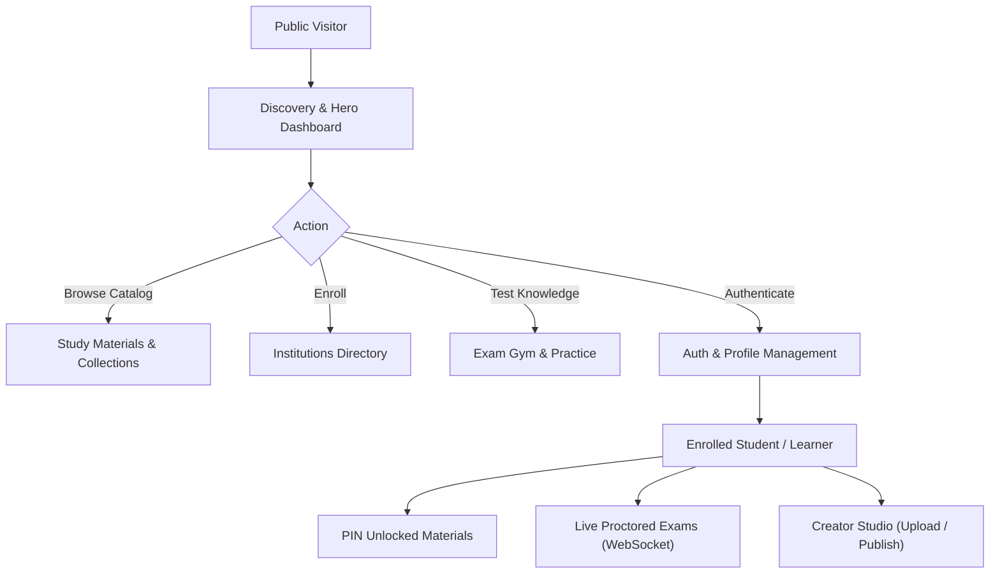
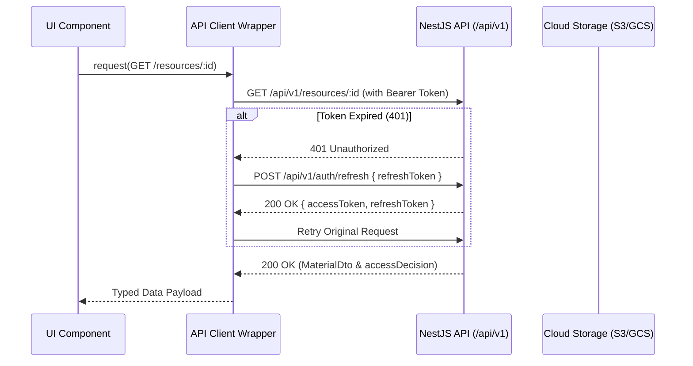
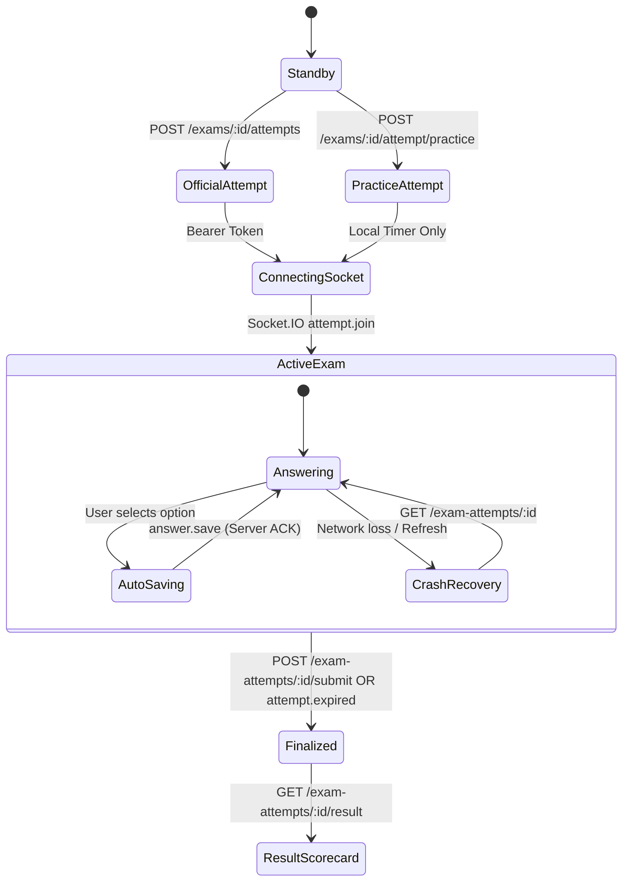

# EduApp Client-Side Frontend Architecture & Design Document
**Target Audience:** Frontend Engineers & Autonomous Coding Agents  
**Scope:** Client-Side Only (Public Guests, Enrolled Students, Learners, and Content Authors). *Excludes internal Admin control panels.*  
**Baseline Reference:** Current Next.js 16.4+ / React 19 / Tailwind CSS v4 Landing Page & Dashboard.

---

## 1. Executive Summary & Design Principles

This document specifies the technical design, directory architecture, state management patterns, and API integration specifications for the EduApp client-facing web application.

The design expands upon the geometric visual language established in the current dashboard:
1. **Symmetric Visual Geometry**: Notched corner containers (`NotchedSectionContainer`), precise Bento grid proportions (40% Videos / 40% Books / 20% Exams), and Coverflow carousels.
2. **Dual View Modes (Rich vs. Wireframe)**: Retaining the wireframe toggle not only as an aesthetic design feature, but as a built-in skeleton/loading state architecture across all routes.
3. **Stateless API & Direct Storage**: Offloading heavy media payloads to direct cloud storage (S3/GCS/MinIO) via 3-step pre-signed URL patterns.
4. **Resilient Realtime Exam Engine**: Zero-loss WebSocket synchronization with local persistence and crash recovery for live exam taking.
5. **Decentralized Access Decision UI**: Dynamic UI adaptation based on server-evaluated `accessDecision` (`FREE`, `PIN_REQUIRED`, `AUTH_REQUIRED`, `ENROLLMENT_REQUIRED`).



---

## 2. Technology Stack & Framework Conventions

| Layer | Technology | Version | Purpose / Architectural Rule |
| :--- | :--- | :--- | :--- |
| **Framework** | Next.js (App Router) | `16.4.3` | Server/Client component boundary, streaming SSR, route groups. |
| **Runtime / UI** | React | `19.3.0` | React Server Components (RSC), `useActionState`, `useOptimistic`. |
| **Styling** | Tailwind CSS | `^4.0` | Turbopack-native CSS engine, custom token variables. |
| **Icons** | Lucide React | `^1.66` | Cohesive stroke iconography. |
| **HTTP Client** | Native `fetch` wrapper | ES2024 | Typed client with Bearer auth, auto-refresh interceptor, retry logic. |
| **Realtime** | Socket.IO Client | `^4.8` | Real-time live exam event streaming (`/exam-live` namespace). |
| **Date & Time** | `date-fns` | `^4.1` | Localized formatting for exam countdowns, timestamps. |

---

## 3. Route Architecture & Page Sitemap

Client-side routes are organized into four dedicated Next.js Route Groups:
* `(public)`: Publicly accessible marketing, catalog, and landing pages.
* `(auth)`: Login, registration, password recovery flows.
* `(app)`: Authenticated student workspaces, libraries, and enrolled institution hubs.
* `(exam-room)`: Distraction-free, full-screen live exam environment.

```
src/app/
├── (public)/
│   ├── layout.tsx                     # Public layout with Global Navbar & Footer
│   ├── page.tsx                       # Current Baseline Landing Dashboard
│   ├── resources/
│   │   ├── page.tsx                   # Filterable Resources Library (PDF & Video)
│   │   └── [id]/page.tsx              # Standalone Resource Viewer & PIN Modal
│   ├── collections/
│   │   ├── page.tsx                   # Collections & Courses Catalog
│   │   └── [id]/page.tsx              # Curriculum Tree & Course Viewer
│   ├── institutions/
│   │   ├── page.tsx                   # Institutions Directory & Search
│   │   └── [id]/page.tsx              # Institution Profile, Resources & Exams
│   ├── articles/
│   │   ├── page.tsx                   # Public Articles & Editorial Feed
│   │   └── [id]/page.tsx              # Article Reader View
│   └── exams/
│       └── page.tsx                   # Public Exams Directory & Practice Gym
├── (auth)/
│   ├── layout.tsx                     # Centered Auth Card Layout with Branding
│   ├── login/page.tsx                 # Sign In Screen
│   ├── register/page.tsx              # Student Registration Screen
│   ├── forgot-password/page.tsx       # Reset Link Request
│   └── reset-password/page.tsx        # Password Reset Confirmation
├── (app)/
│   ├── layout.tsx                     # Authenticated Student Dashboard Shell
│   ├── me/
│   │   ├── profile/page.tsx           # Profile Details & Avatar Upload
│   │   ├── library/page.tsx           # Personal Uploads (Drafts & Published)
│   │   └── exams/page.tsx             # My Exam Attempt History & Grade Reviews
│   ├── studio/
│   │   ├── new-resource/page.tsx      # 5-Step Resource Creation & Direct Upload
│   │   └── new-collection/page.tsx    # Collection Builder & Ordering Studio
│   └── payments/
│       ├── success/page.tsx           # SSLCommerz Payment Success Callback
│       ├── failure/page.tsx           # Payment Failed Notification
│       └── cancelled/page.tsx         # Payment Cancelled Screen
└── (exam-room)/
    └── exams/
        └── [id]/
            └── live/page.tsx          # Full-screen Proctored Exam Arena (WebSocket)
```

---

## 4. Client API & Data Layer Pattern

### 4.1. The API Client & Interceptor Architecture
All HTTP operations route through a centralized client (`src/lib/api/api-client.ts`).



#### Token Management Rules
1. `accessToken` is stored in secure memory or browser storage; `refreshToken` is held in local storage or secure cookie.
2. In-flight requests during a refresh trigger are queued and re-issued once the new token pair arrives.
3. On total refresh failure, client state is cleared, and user is redirected to `/(auth)/login?redirect=<path>`.

### 4.2. Direct-to-Storage Upload Helper (3-Step Pattern)
To ensure the backend server never processes binary media streams:
```ts
// src/lib/api/upload-service.ts
export async function directStorageUpload({
  file,
  purpose,
  resourceId,
  version
}: UploadOptions): Promise<void> {
  // 1. Obtain Ticket
  const intent = await apiClient.post<UploadIntentDto>(`/resources/${resourceId}/uploads`, {
    version,
    purpose,
    fileType: file.type,
    sizeBytes: file.size,
  });

  // 2. Direct PUT / POST to Storage URL (no Auth header!)
  const formData = new FormData();
  Object.entries(intent.fields).forEach(([k, v]) => formData.append(k, v));
  formData.append('file', file);
  await fetch(intent.url, { method: intent.method, body: formData });

  // 3. Complete and Bind
  await apiClient.post(`/resources/${resourceId}/uploads/${intent.fileId}/complete`, {
    version,
  });
}
```

### 4.3. Ephemeral Signed URLs Management
Signed delivery URLs (`/resources/:id/access`, `/resource-collections/:id/cover`, `/resources/:id/thumbnail`) expire after approximately 15 minutes.
* **Never cache signed media URLs** permanently in client persistent storage.
* Wrap media players (`VideoPlayer`, `PdfViewer`) in a lazy-loader that requests a fresh delivery token immediately before playback or reading starts.

---

## 5. Domain Module Specifications

### 5.1. Discovery & Dashboard Module (`src/components/landing-page`)
*Consolidating the baseline.*

* **Hero Coverflow Carousel (`FeaturedCoursesCarousel.tsx`)**:
  * **API**: `GET /api/v1/resource-collections?isFeatured=true&limit=10&sort=newest`
  * **Cover Resolution**: Fetch covers via `GET /api/v1/resource-collections/:id/cover`.
  * **Interactivity**: Clicking "Open" triggers the collection detail modal or navigates to `/collections/[id]`.
* **Featured Videos 40% Column (`FeaturedVideosSection.tsx`)**:
  * **API**: `GET /api/v1/resources?type=VIDEO&isFeatured=true&limit=6&sort=newest`
  * **Interactivity**: "Watch" button fetches pre-signed streaming link via `POST /api/v1/resources/:id/access`.
* **Featured Books 40% Column (`FeaturedBooksSection.tsx`)**:
  * **API**: `GET /api/v1/resources?type=PDF&isFeatured=true&limit=6&sort=newest`
  * **Interactivity**: "Read" opens in-app PDF previewer via `POST /api/v1/resources/:id/access`.
* **Upcoming Certification Exams 20% Column (`UpcomingExamsSection.tsx`)**:
  * **API**: `GET /api/v1/exams/public?page=1&limit=5`
  * **Timer**: Client countdown calculated against `startsAt` / `closesAt`.
  * **Interactivity**: "Register" triggers eligibility check `POST /api/v1/exams/:id/access`.
* **Top Institutions Section (`TopInstitutionsSection.tsx`)**:
  * **API**: `GET /api/v1/institutions?page=1&limit=6`
  * **Stats**: Courses and Exams counts dynamically queried or aggregated.

---

### 5.2. Study Materials & Collection Curriculum Viewer
* **Access Decision Handler**:
  When a user inspects a resource or collection:
  ```ts
  if (access.canAccess) {
    renderAccessGrantedActions(); // Download, Stream, Read
  } else {
    switch (access.reason) {
      case 'PIN_REQUIRED':
        renderPinEntryModal(); // POST /resources/:id/unlock
        break;
      case 'ENROLLMENT_REQUIRED':
        renderInstitutionJoinPrompt(); // POST /institutions/:id/enroll
        break;
      case 'AUTH_REQUIRED':
        renderLoginRedirectPrompt();
        break;
    }
  }
  ```
* **Collection Curriculum Tree**:
  * Left pane: Ordered list from `GET /api/v1/resource-collections/:id/items`.
  * Center pane: Active child resource player.
  * Child media delivered specifically via `POST /api/v1/resource-collections/:id/items/:resourceId/access`.

---

### 5.3. Real-Time Live Exam Taking Arena (`(exam-room)`)
A distraction-free, zero-chrome full-screen experience.



#### Realtime Socket Protocol (`/exam-live` namespace)
1. **Connection**:
   ```ts
   const socket = io(`${process.env.NEXT_PUBLIC_WS_HOST}/exam-live`, {
     auth: { token: accessToken },
     transports: ['websocket']
   });
   ```
2. **Room Registration**: Client emits `attempt.join` `{ attemptId }`.
3. **Autosave Debounce**: Every option selection emits `answer.save` with `{ attemptId, questionId, answer: { selectedOptionIds }, revision }`.
4. **Crash Recovery**: If connection drops or user refreshes, frontend immediately calls `GET /api/v1/exam-attempts/:attemptId` to reconstruct saved answers and synchronize server remaining seconds.
5. **Time Expiration**: Server pushes `attempt.expired` event; client locks the interface immediately and redirects to the Result Scorecard.

---

### 5.4. Student Creator Studio (Client Upload & Curation)
Enables students and tutors to create and publish study materials:
1. **Metadata Step**: Enter Title, Type (`PDF` | `VIDEO`), Access Policy (`FREE` | `PURCHASE`), Price, and PIN.
2. **Direct Upload Step**: Request upload ticket, send binary to cloud storage with progress bar, confirm completion.
3. **Publication Step**: Call `POST /resources/:id/publish` with optimistic locking `version: number`.
4. **Collection Builder**: Drag-and-drop ordering interface that calls `PUT /resource-collections/:id/items/order` with complete array of `resourceIds`.

---

## 6. Directory Structure & File Organization

```
src/
├── app/                               # Next.js App Router (Routes & Layouts)
│   ├── (public)/
│   ├── (auth)/
│   ├── (app)/
│   └── (exam-room)/
├── components/                        # UI Components
│   ├── common/                        # Shared Atomic Design Components
│   │   ├── Navbar.tsx
│   │   ├── Footer.tsx
│   │   ├── Modal.tsx
│   │   ├── NotchedSectionContainer.tsx
│   │   ├── AccessPolicyBadge.tsx
│   │   ├── Button.tsx
│   │   └── Input.tsx
│   ├── landing-page/                  # Baseline Landing Page Components
│   │   ├── FeaturedCoursesCarousel.tsx
│   │   ├── BentoGridSection.tsx
│   │   ├── FeaturedVideosSection.tsx
│   │   ├── FeaturedBooksSection.tsx
│   │   ├── UpcomingExamsSection.tsx
│   │   ├── TopInstitutionsSection.tsx
│   │   ├── SymmetryGridOverlay.tsx
│   │   └── DesignControlsToolbar.tsx
│   ├── materials/                     # Media & Study Material Components
│   │   ├── VideoPlayer.tsx            # HLS / HTML5 Video Player
│   │   ├── PdfViewer.tsx              # PDF Document Canvas
│   │   ├── PinUnlockDialog.tsx        # Secure PIN Entry Modal
│   │   ├── CurriculumSidebar.tsx      # Collection Course Navigator
│   │   └── ResourceUploadDropzone.tsx # Pre-signed Upload Area
│   ├── exams/                         # Live Exam Components
│   │   ├── ExamTimer.tsx              # High-precision Countdown
│   │   ├── QuestionPalette.tsx        # Question Navigator Grid
│   │   ├── QuestionCard.tsx           # Multiple Choice Question Card
│   │   ├── ExamRecoveryBanner.tsx     # Offline / Reconnect Banner
│   │   └── ExamResultScorecard.tsx    # Graded Breakdown Display
│   └── institutions/                  # Institutions Components
│       ├── InstitutionCard.tsx
│       ├── EnrollmentButton.tsx       # Smart Enroll Action (Free/Pay/Apply)
│       └── InstitutionHero.tsx
├── hooks/                             # Custom React Hooks
│   ├── useAuth.ts                     # Session & User Profile State
│   ├── usePublicSearch.tsx            # Global Search & accessFilter Context
│   ├── useExamSocket.ts               # Socket.IO Event Synchronizer
│   ├── useCountdown.ts                # Precise Tick Timer Hook
│   └── useMediaAccess.ts              # Ephemeral URL Resolver & Refresher
├── lib/                               # Core Utilities & Configurations
│   ├── api/
│   │   ├── api-client.ts              # Typed fetch wrapper with 401 interceptor
│   │   ├── endpoints.ts               # Centralized API Route URL Constants
│   │   └── upload-service.ts          # Direct-to-Storage 3-step handler
│   ├── socket/
│   │   └── socket-client.ts           # Socket.IO factory and reconnection logic
│   └── utils/
│       ├── formatting.ts              # Currency (BDT), Date, and Duration formatters
│       └── optimistic.ts              # Optimistic version conflict resolution
└── types/                             # TypeScript Contracts
    ├── api.types.ts                   # PageDto, UploadIntentDto, MediaDto
    ├── auth.types.ts                  # User, TokenPair, LoginDto
    ├── material.types.ts              # BaseMaterial, CollectionItem, VideoItem, BookItem
    ├── exam.types.ts                  # Exam, Question, Attempt, SocketEvents
    └── institution.types.ts           # Institution, EnrollmentStatus
```

---

## 7. State Management & Data Fetching Guidelines

| State Scope | Pattern / Tool | Justification |
| :--- | :--- | :--- |
| **Server / Data Cache** | Next.js Server Components + `fetch` caching | Maximum SEO, instantaneous first paint for public catalogs. |
| **Client Query Cache** | Custom SWR-like caching hook or TanStack Query | Instant search/filter re-renders, pagination, and mutation invalidation. |
| **Authentication State** | `AuthContext` + Local Storage / Cookies | Broadcasts session state across Navbar, Profile, and Protected routes. |
| **Active Live Exam** | `useReducer` + LocalStorage buffer | Deterministic, immutable state updates for question answers with instant disaster recovery. |
| **Design Controls** | React Context (`usePublicSearch`, viewMode) | Controls `rich` vs `wireframe` and `showSymmetryGrid` across modules. |

---

## 8. Agent Implementation Roadmap

This roadmap organizes future implementation tasks into distinct, verifiable phases for coding agents:

```
[Phase 1: Core Client Infrastructure]
  ├── Build `api-client.ts` with auto-refresh token interceptor
  ├── Setup `upload-service.ts` for pre-signed direct-to-storage uploads
  └── Implement `AuthContext` and route protection middleware

[Phase 2: Hydrate Baseline Dashboard]
  ├── Connect `FeaturedCoursesCarousel` to `GET /resource-collections?isFeatured=true`
  ├── Connect `FeaturedVideosSection` to `GET /resources?type=VIDEO&isFeatured=true`
  ├── Connect `FeaturedBooksSection` to `GET /resources?type=PDF&isFeatured=true`
  ├── Connect `UpcomingExamsSection` to `GET /exams/public`
  └── Connect `TopInstitutionsSection` to `GET /institutions`

[Phase 3: Material Viewing & PIN Flow]
  ├── Build `PinUnlockDialog` modal connected to `POST /resources/:id/unlock`
  ├── Build `VideoPlayer` & `PdfViewer` components utilizing ephemeral access URLs
  └── Build Collection Curriculum viewer (`/collections/[id]`)

[Phase 4: Institutions & Enrollment]
  ├── Implement `/institutions` directory and `/institutions/[id]` profile
  └── Implement `EnrollmentButton` supporting Free, Paid (SSLCommerz redirect), and Application types

[Phase 5: Real-time Live Exam Room]
  ├── Build full-screen `(exam-room)` layout
  ├── Implement `useExamSocket` for `/exam-live` autosaving
  ├── Add crash recovery via `GET /exam-attempts/:attemptId`
  └── Build `ExamResultScorecard` for post-test evaluation

[Phase 6: Student Creator Studio]
  ├── Multi-step draft creation for PDFs and Videos
  └── Collection curriculum reordering via drag-and-drop
```

